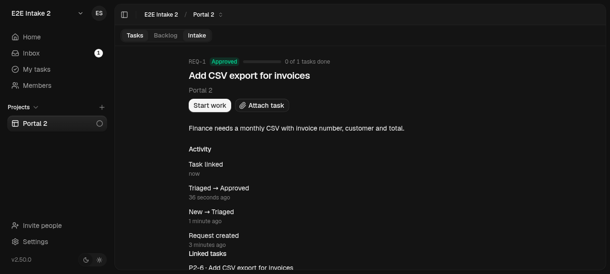
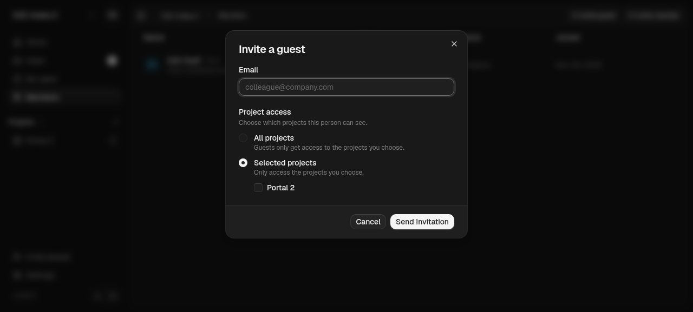
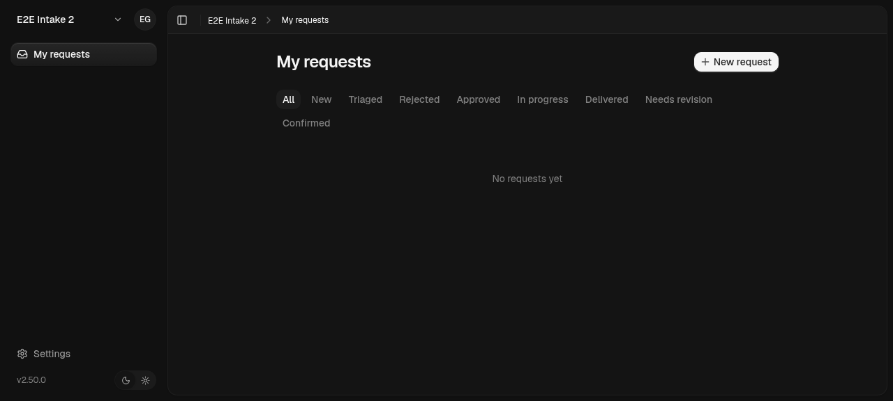
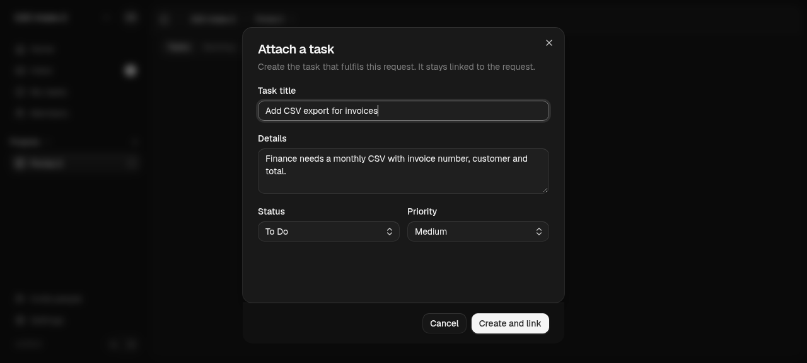
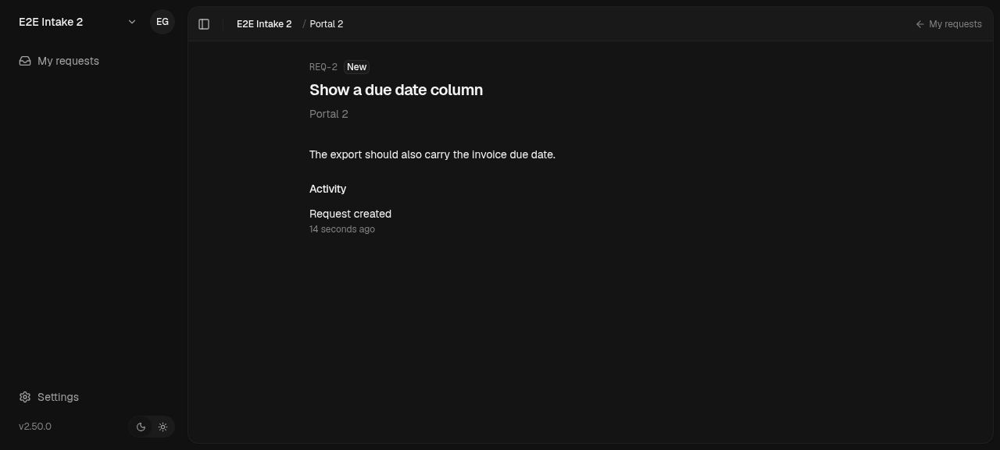
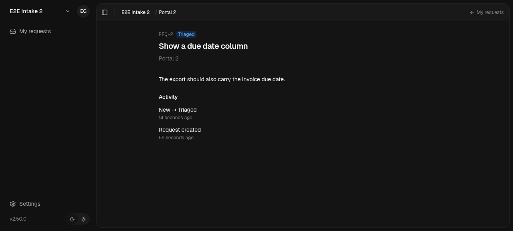

# Intake portal — second end-to-end run, 2026-11-24

Replaces `docs/superpowers/reports/2026-11-24-intake-e2e/report.md`, which is
kept for the before/after screenshots of the defects it caught.

Fixes under test: `62f5aed8` (the five minor defects the first run recorded),
on top of `4587304c`. Environment: local dev (API `http://localhost:1337`, web
`http://localhost:5173`, Postgres in `kaneo-dev-pg`), driven with `agent-browser`
in two independent sessions, one per account.

Accounts and data, freshly created for this run:

| | |
| --- | --- |
| Staff | `e2e2-staff@test.local`, owner of workspace "E2E Intake 2" (`qe5yYhZoMgMMeeKfRcMWodKv2rmRvBWm`) |
| Guest | `e2e2-guest@test.local`, role `guest`, invited with selected-project access |
| Project | "Portal 2", key `P2` (`tgjdp6dfkn7m63ajlweh7za3`), intake switched on |
| Requests | `REQ-1` (full lifecycle, twice through revision), `REQ-2` (realtime probe) |

The first run's accounts and project still exist but were not reused: a clean
workspace keeps the guest invitation and the realtime probe honest.

## What this run covered

| Step | Expected | Result |
| --- | --- | --- |
| Switch intake on in project settings | Switch persists, page reloads on | Yes — `01-intake-switch-on.png` |
| Invite a guest | Guest-only copy about project access | Yes — `02-invite-guest-copy.png` |
| Guest lands in the portal | No Search, no project list, workspace named | Yes — `03-guest-portal.png` |
| Guest files a request | Appears as `REQ-1`, New | Yes — `04-guest-created-request.png` |
| Staff triages and approves | New → Triaged → Approved | Yes |
| Attach task dialog | Column and priority names, not slugs | Yes — `05-attach-dialog-labels.png` |
| Linked task | Full key `P2-6`, not a bare number | Yes — `06-linked-task-key.png` |
| Start work → deliver | In progress → Delivered | Yes — `07-staff-delivered.png` |
| Guest asks for changes | needs_revision with the note visible | Yes — `09-guest-needs-revision.png` |
| Staff picks it up and re-delivers | revision → in progress → delivered | Yes — `10-staff-sees-revision.png` |
| Guest confirms | Delivered → Confirmed, `confirmed_at` set | Yes — `11-guest-confirmed.png` |
| Guest opens the board | Blocked, no task data | Yes — `12-guest-board-blocked.png` |
| Members table | Guest row marked Guest, one project | Yes — `13-members-guest-badge.png` |
| Realtime between two sessions | Guest sees the status change without reloading | **No** — `14`, `15` |

The `needs_revision` branch — the gap the first report admitted — ran end to
end this time, in both directions: the guest's note reached staff, and staff
moving it back to in progress and delivered again reached the guest.

## The five fixes, verified in the browser

1. **Linked task key.** Before: `12 · Build the export`. After: `P2-6 · Add CSV
   export for invoices` — `06-linked-task-key.png`.

   

2. **Guest invitation copy.** Before: the guest invitation borrowed "Your own
   access is limited…", which describes a restricted inviter, not a guest. After
   it says guests only get the projects you choose —
   `02-invite-guest-copy.png`.

   

3. **Guest sidebar.** Before: a Search button and an empty "Projects" group,
   both dead ends for a guest. After they are gone, and the workspace shows its
   name instead of a bare id — `03-guest-portal.png`.

   

4. **Workspace name for a guest.** `/organization/list` omits a workspace the
   guest cannot read, so the switcher had no name. `GET
   /workspace/{id}/membership` now carries `workspaceName`, and the sidebar
   header renders "E2E Intake 2" — same screenshot as above.

5. **Attach-task dialog.** Before: `to-do` and `medium`. After: "To Do" and
   "Medium", taken from the column name and the translated priority —
   `05-attach-dialog-labels.png`.

   

## The finding this run adds: intake has no live updates

The first report listed realtime as untested. It is now tested, and it fails on
both sides.

With the guest's `REQ-2` detail page open, staff marked the request triaged.
The guest page still read **New** — `14-guest-stale-no-reload.png`.
Reloading the same URL showed **Triaged** — `15-guest-after-reload.png`. The
write reached the database; nothing pushed it to the open page.

| Without a reload | After a reload |
| --- | --- |
|  |  |

Two causes, both read from code rather than measured with a socket trace:

- The API publishes `intake_request.updated`, but the socket audience is built
  from `PROJECT_READ_PERMISSIONS` (`apps/api/src/ws/project-read-access.ts`); a
  guest holds no `project:read`, so a guest socket never receives the event.
- `apps/web/src/hooks/use-project-websocket.ts` has no branch for
  `intake_request.updated` at all, so even a staff member's open intake page
  ignores it.

Neither is fixed here: the first needs the broadcast audience to include the
requester, the second needs an invalidation branch for the intake query keys.
Both are small, but they change delivery rules rather than the five recorded
defects, so they are written up instead of folded into this run.

## Screenshot index

Fifteen files in `screenshots/`, in the order the run happened:

- `01-03` intake switch, guest invitation, guest portal
- `04-06` the request, the attach dialog, the linked task key
- `07-11` deliver, guest sees it, needs revision, staff rework, confirm
- `12-13` the board refusal, the members table
- `14-15` the realtime probe, before and after a reload

## What this run did not check

- Realtime for staff: inferred from the missing branch in the socket hook, not
  observed in a second staff session.
- Notifications and email, which are Phase 4.
- A second guest, so nothing was learned about two guests on one project.
- The mobile app.
- Long-running behaviour: no request was left open overnight, no large list was
  loaded to check pagination under a guest.

## Gates

- Focused web tests: `src/components/intake` and
  `src/components/team/invite-team-member-modal.test.tsx` — 33 tests, all pass.
- `pnpm exec vp check` on the changed files — format and lint clean.
- `pnpm i18n:check` — every locale in sync after the new guest string.
- `apps/docs/openapi.json` regenerated for `projectSlug` and `workspaceName`.
- Fork CI: run `45390351988` on `fa81054f`, all five jobs green after the review
  pass that folded `get-my-membership` into one join and named the invitation
  note key. The local box does not typecheck `apps/web` (it needs more memory
  than this machine has), so that gate is CI-only.
